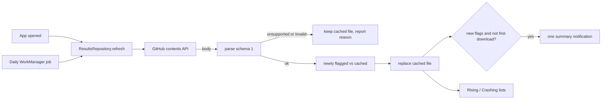

# Retro Analytics Android App - Plan

## Goal Capsule

- **Objective:** The owner opens an app on their own Android phone and sees which of their tracked retro games are rising and which are crashing in price, and gets a phone notification when a game newly does either, using the results their PC publishes each week.
- **Product authority:** The owner's intent as relayed by firstmate. This plan covers the Android app only; the pipeline that detects and publishes the flags is a separate plan and pull request and is not active scope here.
- **Open blockers:** None.
- **Means:** a native Compose app with one refresh path shared by app open and a daily worker (KTD1-KTD8).
- **Stop conditions:** stop and ask firstmate if a requirement needs a product change or the toolchain cannot build without root.
- **Who finishes:** the firstmate crewmate implements on `fm/ra-android` and ships through `/no-mistakes`; this pull request merges after the pipeline pull request.

---

## Product Contract

### Summary

A personal Android app, built in Kotlin with Jetpack Compose and installed from a debug APK, that downloads the weekly results file from the owner's private results repository with a read-only token pasted in once.
It shows Rising and Crashing tabs with a console filter and sort, a detail page per game with its price history and forecast chart, works offline from the last download, and notifies the owner when a game is newly flagged.

### Problem Frame

retro-analytics runs on the owner's PC and its only views are a CSV and an HTML file on that PC.
The owner wants to check rising and crashing games from their phone without the phone doing any scraping or modelling.
PriceCharting's terms allow personal use only, so the app is for the owner alone: no Play Store, no public data source, no other users.

### Key Decisions

- **Native Kotlin and Jetpack Compose app, sideloaded as an APK.** (session-settled: user-approved — chosen over a Play Store listing or a web app: personal use under PriceCharting's terms, installed straight from a file.) Governs R1, R16.
- **The phone only downloads and displays.** (session-settled: user-approved — chosen over running models on the phone: the PC already scrapes and forecasts weekly.) The PC's flags decide what appears in each tab. Governs R7, R8.
- **Private GitHub repository plus a read-only token pasted once.** (session-settled: user-approved — chosen over a public URL or a self-hosted server: only the owner can read it.) Governs R2, R3, R4.
- **A notification means "newly flagged since the last download".** The PC already applies the owner's thresholds, so the app compares each download with the previous one instead of keeping a second set of thresholds. Governs R12, R13.

### Requirements

**Setup and data access**

- R1. The app installs from a debug APK on a current Android phone (Android 8.0 or newer) and needs no Google account or Play Store.
- R2. A settings screen takes a GitHub fine-grained read-only token and the results file location; the default location is `results/latest.json` on `main` in `alutterb/retro-analytics-data`, read through the GitHub contents API.
- R3. The token is stored only in Android encrypted storage, is never written to logs, and is shown masked once saved.
- R4. Settings can test the connection and report a clear reason when it fails: bad token, missing file, no network, or a file the app does not understand.

**Fetching and offline**

- R5. The app downloads the results file when opened and on a background job about once a day while the phone has a network connection.
- R6. The last successful download is kept on the phone; with no network the app shows it with its generation date and a note that it may be stale.
- R7. A file whose schema version the app does not support is rejected with a message asking to update the app, and the last good data stays on screen.

**Browsing**

- R8. Two tabs, Rising and Crashing, list the games the PC flagged in that direction; a game flagged both ways appears in both.
- R9. Each list row shows title, console, current CIB price and the change that flagged it.
- R10. A console filter applies to both tabs, and the list can be sorted by size of move, current price or title.
- R11. Tapping a game opens a detail page with its price history chart followed by the forecast drawn as a distinct dashed continuation, its 1-, 3- and 6-month changes, its forecast growth, every flag reason, and a link to its PriceCharting page when the file has one.

**Notifications**

- R12. After each download, the app posts a local notification for games that are flagged now but were not flagged in that direction in the previous download.
- R13. The first download after install notifies nothing, so setup does not produce a burst of notifications.
- R14. Tapping a notification opens the app; several newly flagged games in one download produce one summary notification rather than one per game.
- R15. On Android 13 and newer the app asks for notification permission; if refused, everything except notifications still works.

**Build and delivery**

- R16. `./gradlew assembleDebug` builds the APK from the repository with the committed Gradle wrapper, and the README documents installing the Android SDK and a supported JDK in the user's home without root, building, and installing the APK by `adb install` or file transfer.
- R17. Unit tests cover parsing the results file and deciding which games are newly flagged.

### Acceptance Examples

- AE1. **Covers R12, R13.** Given a fresh install, when the first download flags 12 games, then no notification is posted.
- AE2. **Covers R12, R14.** Given the previous download flagged Chrono Trigger as rising, when the new one flags it rising again and newly flags Earthbound as crashing and Zelda as rising, then one notification announces 2 newly flagged games, and Chrono Trigger is not counted.
- AE3. **Covers R12.** Given a game rising last week and crashing this week, then it counts as newly crashing.
- AE4. **Covers R6.** Given the phone is offline, when the app opens, then the last data shows with its date and a stale note, and no error replaces it.
- AE5. **Covers R7.** Given the PC publishes a file with an unsupported schema version, then the app keeps the previous data and says the app needs updating.

### Scope Boundaries

- Play Store listing, release signing, or any other user than the owner.
- Running scrapes or forecasts on the phone.
- App-side thresholds separate from the PC's: deferred; the PC's settings are the one place thresholds change.
- Home-screen widgets, watchlists, search, and price alerts on games the PC did not flag.
- iOS.

### Dependencies / Assumptions

- The results file format is the versioned JSON defined by the pipeline plan (`docs/plans/2026-10-23-1930-feat-rising-crashing-export-plan.md` on the pipeline branch): flagged games only, each with identity, console, current price, recent changes, forecast, 24 months of history and flag reasons.
- The owner creates the fine-grained token with read-only Contents access to the results repository.

### Outstanding Questions

- Deferred to Planning: chart drawing approach, storage library choice, exact minSdk and target SDK numbers within R1.

<!-- ce-section: work-relationships -->
### How This Work Fits Together

This plan covers the phone half of putting retro-analytics on the owner's phone. The breakdown below is the current understanding, not a committed roadmap.

- Pipeline detection, export and publish: Enables this app; the app depends on its file format and on the weekly publish. Merges first.

---

## Planning Contract

Product Contract preservation: Product Contract unchanged; plan review added screen states, a refresh-failure notice and a host check as implementation detail under existing R4-R7, R10-R14 (see U3-U5).

### Assumptions

- Firstmate confirmed the scope (call-outs C7-C9) and told the run to continue through the loop, so plan-time bets are recorded here rather than asked.
- This pull request is based on `main` and does not depend on the pipeline pull request's code; the results-file format is restated below (KTD3) so the app can be built and tested on its own. The pipeline pull request merges first.
- Toolchain on the build machine: Temurin JDK 21 in `~/.local/jdks/jdk-21`, Android SDK in `~/Android/Sdk` (command-line tools, platform-tools, platforms 36 and 37.0, build-tools 36.0.0), all user-local. Versions current at planning time: Android Gradle Plugin 9.4.1, Gradle 9.8.2, Kotlin 2.4.21, Compose BOM 2026.09.00.
- Daily background refresh is often enough: the PC publishes weekly.

### Key Technical Decisions

- KTD1. **One `app` Gradle module under `android/`, version catalog, committed Gradle wrapper, JDK 21 toolchain.** Gradle 9.8.2 wrapper, AGP 9.4.1 with its built-in Kotlin support, the Kotlin Compose compiler and serialization plugins at the Kotlin version, `compileSdk` 37 (the Compose BOM 2026.09.00 libraries declare minCompileSdk 37 in their AAR metadata), `targetSdk` 36, `minSdk` 26 (R1, R16).
- KTD2. **No third-party networking, chart or storage libraries.** `HttpURLConnection` for one authenticated GET, Compose `Canvas` for the chart, files in app storage for the cache, `kotlinx.serialization` for JSON. Fewer dependencies keep the APK small and the build reliable (R5, R11).
- KTD3. **Results-file contract, schema version 1** (written by the pipeline's `ra export`): top-level `schema_version` (int), `generated` (ISO date), `horizon_months` (int), `thresholds` (`rising`/`crashing` maps of `forecast_pct`, `change_1m_pct`, `change_3m_pct`, `change_6m_pct`), `games` (array). Prices (`last_price`, every `prices[]`) are complete-in-box prices in US dollars. Each game: `console`, `game` (slug), `title`, `url` (nullable), `last_month`, `last_price`, `changes_pct` (`1m`/`3m`/`6m`, each nullable), `forecast` (`growth_pct` nullable, `months[]`, `prices[]`), `history` (`months[]`, `prices[]`), `flags[]` (`direction` `rising`|`crashing`, `signal`, `value_pct`, `threshold_pct`, `text`). The app models only the fields a requirement reads (identity, title, url, last month and price, changes, forecast growth and points, history, and each flag's direction, value and text); `thresholds`, `horizon_months` and the other flag fields are ignored like any unknown key, so the PC can change them without breaking the app. Any `schema_version` other than 1 is unsupported (R7).
- KTD4. **Token in Android Keystore-backed encryption.** An AES-GCM key generated in the Android Keystore (never exportable) encrypts the token; only ciphertext and IV are stored in app preferences. The deprecated Jetpack security-crypto library is avoided. The token never reaches logs, exceptions or UI except masked. The manifest sets `android:allowBackup="false"` (Keystore keys are never backed up, so restored ciphertext would be undecryptable), and a decryption failure counts as no saved token (R3).
- KTD5. **GitHub contents API with the raw media type.** `GET https://api.github.com/repos/alutterb/retro-analytics-data/contents/results/latest.json?ref=main` with `Authorization: Bearer <token>`, `Accept: application/vnd.github.raw+json`, `X-GitHub-Api-Version: 2022-11-28`. The settings screen stores this URL, prefilled, so another path or branch is a text edit. The client sends the token only to an `https` URL on host `api.github.com` and otherwise fails with a clear reason (R2, R4).
- KTD6. **One refresh path for app open and the worker.** A repository object fetches, parses, compares with the cached file, stores the new file, and returns the newly flagged list; the UI and a daily `PeriodicWorkRequest` (network-connected constraint, unique work, keep existing) both call it, and only a successful parse replaces the cache (R5-R7, R12).
- KTD7. **"Newly flagged" compares (console, game, direction) pairs** between the previous cached file and the new one; no previous file means nothing is new. Saving a different results location clears the cache, so the next download counts as a first download (R12, R13).
- KTD8. **CI builds the app.** A second job in `.github/workflows/tests.yml` installs platform 37 and runs the unit tests and `assembleDebug` on JDK 21, so later changes cannot silently break the APK the owner rebuilds only occasionally (R16, R17).

### High-Level Technical Design



Screens: a top bar with the data date and a settings action; two tabs (Rising, Crashing); a console filter chip row and a sort menu shared by both tabs; tapping a row opens the detail page; system back returns.

### Output Structure

```text
android/
  settings.gradle.kts, build.gradle.kts, gradle.properties, gradlew, gradlew.bat
  gradle/libs.versions.toml, gradle/wrapper/
  app/build.gradle.kts
  app/src/main/AndroidManifest.xml, res/
  app/src/main/kotlin/io/github/alutterb/retroanalytics/
    data/   Results.kt, NewlyFlagged.kt, Browse.kt, ResultsStore.kt, GitHubClient.kt, TokenStore.kt, ResultsRepository.kt
    work/   RefreshWorker.kt, Notifier.kt
    ui/     MainActivity.kt, AppViewModel.kt, ListScreen.kt, DetailScreen.kt, PriceChart.kt, SettingsScreen.kt, Theme.kt
  app/src/test/kotlin/io/github/alutterb/retroanalytics/data/
    ResultsTest.kt, NewlyFlaggedTest.kt, BrowseTest.kt
  README.md
```

---

## Implementation Units

### U1. Gradle project and toolchain

**Goal:** an empty Compose app that builds with `./gradlew assembleDebug` from the committed wrapper.
**Requirements:** R1, R16.
**Dependencies:** none.
**Files:** `android/settings.gradle.kts`, `android/build.gradle.kts`, `android/gradle.properties`, `android/gradle/libs.versions.toml`, `android/gradle/wrapper/*`, `android/gradlew`, `android/gradlew.bat`, `android/app/build.gradle.kts`, `android/app/src/main/AndroidManifest.xml`, `android/app/src/main/res/**`, `.gitignore`.
**Approach:**
1. Generate the wrapper with a downloaded Gradle 9.8.2 distribution kept outside the repo.
2. Catalog pins per KTD1; `local.properties` stays untracked (SDK path comes from `ANDROID_HOME` or that file).
3. Manifest declares `INTERNET`, `ACCESS_NETWORK_STATE`, `POST_NOTIFICATIONS`; launcher icon as an adaptive vector.
**Execution note:** packaging work; prove it with a build, not unit tests.
**Test expectation:** none -- scaffolding; verified by `assembleDebug` producing an APK.
**Verification:** `./gradlew assembleDebug` succeeds with JDK 21 and the user-local SDK.

### U2. Results parsing and pure logic

**Goal:** parse schema 1, decide newly flagged games, filter and sort lists.
**Requirements:** R7, R8, R9, R10, R12, R13, R17.
**Dependencies:** U1.
**Files:** `android/app/src/main/kotlin/.../data/Results.kt`, `.../data/NewlyFlagged.kt`, `.../data/Browse.kt`, tests `ResultsTest.kt`, `NewlyFlaggedTest.kt`, `BrowseTest.kt`.
**Approach:** serializable models per KTD3 with lenient unknown keys; `parse(text)` returns success, unsupported version (with the version), or invalid (with a short reason); "required" means a consumed, non-nullable field. `newlyFlagged(previous, current)` per KTD7. List helpers: games for a direction, console filter, and sort. Each row's headline flag is the flag in that direction with the largest absolute value; sort by move (default, descending) uses that value, then price descending, then title. Filter and sort reset on restart. The notification summary text is built here too.
**Execution note:** test-first.
**Test scenarios:**
- A valid schema-1 file with two games parses; nullable `url`, `changes_pct.6m` and `forecast.growth_pct` come back null.
- Unknown extra fields at top level and inside a game are ignored.
- `schema_version` 2 returns unsupported with version 2.
- Malformed JSON and a missing required field return invalid.
- Covers AE1. No previous file: nothing is newly flagged.
- Covers AE2. Previous rising Chrono; current rising Chrono, crashing Earthbound, rising Zelda: newly flagged is Earthbound crashing and Zelda rising.
- Covers AE3. Previous rising, current crashing for the same game: newly crashing.
- A game flagged both ways appears in both direction lists.
- Console filter keeps only that console; "all" keeps everything.
- Sort by move (default) orders by the largest absolute flag value in that direction; by price descending; by title alphabetically.
- The headline flag for a game with two crashing flags is the one with the larger absolute value.
- Summary text for two newly flagged games names both with their direction.
**Verification:** `./gradlew test` passes.

### U3. Storage, network and refresh

**Goal:** fetch with the stored token, cache the last good file, and report clear failures.
**Requirements:** R2, R3, R4, R5, R6, R7, R12, R13.
**Dependencies:** U2.
**Files:** `.../data/TokenStore.kt`, `.../data/GitHubClient.kt`, `.../data/ResultsStore.kt`, `.../data/ResultsRepository.kt`.
**Approach:**
1. `TokenStore` per KTD4; URL stored in the same preferences, defaulting per KTD5.
2. `GitHubClient` refuses any URL that is not `https://api.github.com/...` before sending the token, maps HTTP 401/403 to bad token, 404 to missing file or no access, `IOException` to no network; 15 s connect and 30 s read timeouts.
3. `ResultsStore` writes the raw text atomically (temp file then rename) and reads it back on start.
4. `ResultsRepository.refresh()` per KTD6, returning the outcome and newly flagged list.
**Patterns to follow:** keep Android types out of the pure logic in U2 so tests stay on the JVM.
**Test expectation:** none -- thin Android-framework wrappers; the decision logic they call is covered in U2, and the whole path is exercised on the built APK.
**Verification:** builds; manual run against the private repository is the owner's step after installing.

### U4. Background refresh and notifications

**Goal:** daily refresh in the background and one summary notification for newly flagged games.
**Requirements:** R5, R12, R13, R14, R15.
**Dependencies:** U3.
**Files:** `.../work/RefreshWorker.kt`, `.../work/Notifier.kt`, `AndroidManifest.xml`.
**Approach:** unique periodic work every 24 hours with a connected-network constraint, enqueued on app start; `Notifier` creates one channel, posts a single notification ("2 newly flagged: Earthbound crashing, Zelda rising") whose tap opens `MainActivity` on the tab of the first listed game, and skips silently without permission. When a background refresh is rejected for a bad token, the worker posts one low-priority "Refresh failing: token rejected" notice, at most once until a refresh succeeds, because fine-grained tokens expire and a silent worker would look like "nothing new".
**Test expectation:** none -- framework glue; message text building can live in U2's pure code if it grows logic.
**Verification:** builds; WorkManager enqueues without crashing on app start.

### U5. Screens

**Goal:** settings, Rising/Crashing lists with filter and sort, and the detail page with chart.
**Requirements:** R2, R3, R4, R6, R8, R9, R10, R11, R15.
**Dependencies:** U3, U4.
**Files:** `.../ui/MainActivity.kt`, `.../ui/AppViewModel.kt`, `.../ui/ListScreen.kt`, `.../ui/DetailScreen.kt`, `.../ui/PriceChart.kt`, `.../ui/SettingsScreen.kt`, `.../ui/Theme.kt`.
**Approach:**
1. `AppViewModel` loads the cache, refreshes on start, and exposes state: data, last outcome, filter, sort, selected game.
2. First launch without a token opens settings. Settings has the token field (a masked placeholder once saved; typing replaces it), the URL field, Save and Test connection. Test uses the values on screen without saving, shows progress, then either the failure reason or "Connected: N flagged games, generated <date>". Save stores both, asks for notification permission on Android 13+, starts a refresh and returns to the lists.
3. Lists show title, console, CIB price and the headline flag text for that direction, with a "New" marker on games newly flagged in the latest download. Above the lists, one banner shows the data date when offline (R6), or the failure reason (bad token, missing file, file not understood, unsupported version) when the last refresh failed, with a Settings action for token or location problems; cached lists stay visible (R6, R7). With no cache: a progress indicator during the first download, or a no-data screen with the reason, Retry and Settings. Empty tab: "No games flagged rising/crashing". Empty filter result: "No games for this console".
4. Detail draws history as a solid line and forecast as a dashed continuation on a Canvas with min/max labels, lists changes, growth and reasons, and opens the PriceCharting link in the browser.
5. The notification tap's tab choice arrives as an intent extra.
**Test expectation:** none -- Compose UI; logic it shows is in U2. Verified on the built APK.
**Verification:** `assembleDebug` builds; screens compile against the view model.

### U6. Docs and CI

**Goal:** the owner can set up the toolchain, build, install and configure the app, and CI keeps it building.
**Requirements:** R16.
**Dependencies:** U1-U5.
**Files:** `android/README.md`, `README.md`, `.github/workflows/tests.yml`.
**Approach:** `android/README.md` covers the user-local JDK 21 and SDK install, `./gradlew assembleDebug`, the APK path, `adb install -r` and the file-transfer route, creating the fine-grained token, and first-run settings; the root README links to it; CI adds an `android` job per KTD8.
**Test expectation:** none -- documentation and CI config.
**Verification:** CI job definition is valid YAML; README commands match what was run locally, including installing platform 37.

---

## Verification Contract

- From `android/`: `./gradlew test` and `./gradlew assembleDebug` pass with `JAVA_HOME` pointing at JDK 21 and `ANDROID_HOME` at the SDK.
- The debug APK exists at `android/app/build/outputs/apk/debug/app-debug.apk`.
- `uv run pytest -q` still passes (no Python changes expected).
- Every new or changed file is under 500 lines; no token, credential, price data or `local.properties` is committed.

## Definition of Done

- U1-U6 land; unit tests cover parsing and newly-flagged logic.
- The APK builds locally and in CI.
- `android/README.md` documents toolchain setup, building, installing and configuring.
- No abandoned experimental code remains.
